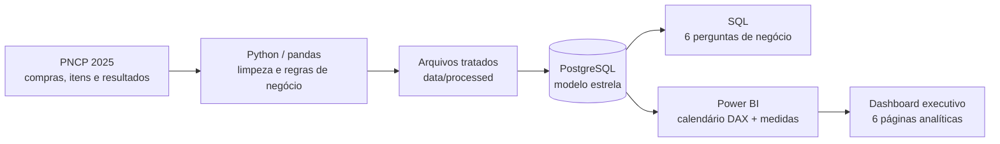
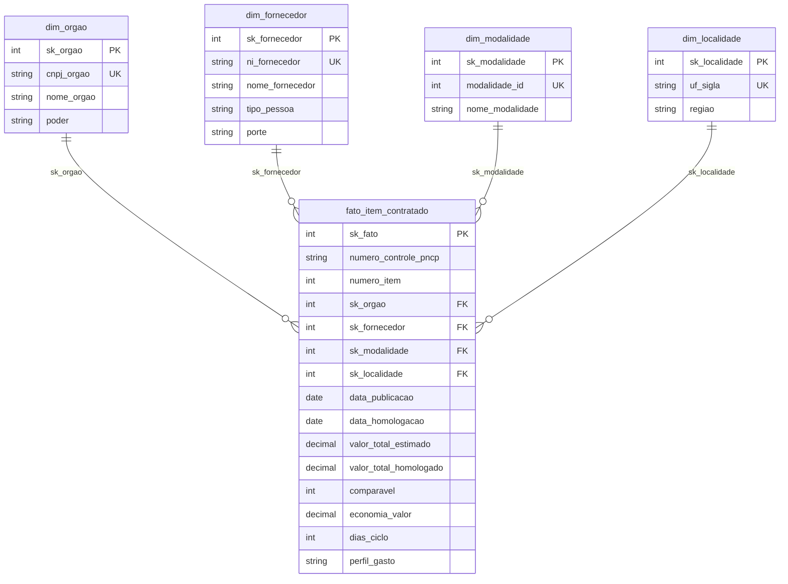
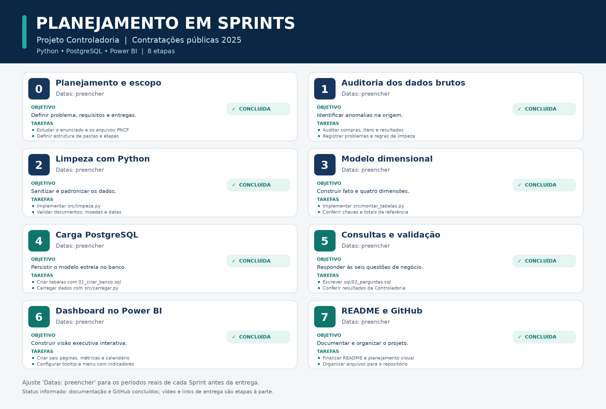

# Controladoria de Contratações Públicas | PNCP 2025

**Projeto avaliativo — Análise de Dados com Python e PostgreSQL | Módulo 2**

Pipeline de dados de ponta a ponta para auditoria, tratamento e análise de contratações públicas federais, com **Python**, **PostgreSQL** e um **dashboard executivo em Power BI**.

> **Fonte dos dados:** Portal Nacional de Contratações Públicas (PNCP) / Dados Abertos do Governo Federal. O projeto utiliza o recorte de **2025**, a partir dos arquivos `compras.csv`, `itens.csv` e `resultados.csv` fornecidos para a atividade.

## Links da apresentação e do dashboard

| Recurso | Acesso |
|---|---|
| **Vídeo de apresentação (Loom)** - **** |
| **Dashboard Power BI (publicado)** - **projeto_controladoria.pbix** |
| **Vídeo no Google Drive — entrega exigida no enunciado** - **** |

## 1. Contexto e problema de negócio

Dados de compras públicas podem apresentar inconsistências cadastrais, valores monetários em diferentes formatos, datas inválidas, resultados cancelados e múltiplos fornecedores classificados para o mesmo item. Sem tratamento, essas situações comprometem os indicadores de economia, concentração, tempo de contratação e distribuição dos gastos.

O objetivo deste projeto é transformar arquivos operacionais em uma base analítica consistente, auditável e adequada à tomada de decisão da Controladoria, respondendo a seis questões:

1. Quanto o governo economizou nas contratações comparáveis?
2. Quais fornecedores concentram o maior volume homologado?
3. Quais modalidades concentram recursos e apresentam maiores percentuais de economia?
4. Quanto tempo decorre entre a publicação e a homologação, e quais órgãos apresentam ciclos mais longos?
5. Como o volume contratado e a economia se distribuem entre regiões e unidades federativas?
6. Qual é o perfil do gasto entre bens, serviços e obras/engenharia?

## 2. Tecnologias e arquitetura

| Camada | Tecnologia | Finalidade |
|---|---|---|
| Origem | CSVs do PNCP / dados abertos | Dados de contratações, itens e resultados |
| Tratamento | Python + pandas | Normalização, validações, regras de negócio e dimensões |
| Persistência | PostgreSQL + psycopg2 | Armazenamento relacional e controle de integridade |
| Consultas | SQL | Respostas auditáveis para as seis perguntas de negócio |
| Análise e visualização | Power BI + DAX | Indicadores, filtros, comparações, navegação e narrativa executiva |
| Versionamento | Git + GitHub | Histórico e disponibilização dos artefatos |



### Modelagem dimensional

O PostgreSQL armazena uma **tabela fato** (`fato_item_contratado`) e **quatro dimensões** (`dim_orgao`, `dim_fornecedor`, `dim_modalidade` e `dim_localidade`). Cada registro da fato representa **um item de contratação**, identificado pelo par `numero_controle_pncp` + `numero_item`.



No Power BI, a dimensão de tempo é complementada por uma **tabela Calendário criada em DAX**, permitindo análises por datas, anos e meses. A presença e o comportamento das relações de datas devem ser conferidos no arquivo `.pbix` final.

## 3. Tratamento e regras de negócio

O pipeline implementa regras determinísticas para limpar os dados, selecionar um resultado por item e construir indicadores comparáveis.

### Dicionário das inconsistências e decisões

| Inconsistência / situação | Tratamento adotado | Implementação |
|---|---|---|
| Espaços extras, caracteres invisíveis, textos nulos e acentuação corrompida | Limpeza, normalização e recuperação de acentos quando possível | `src/limpeza.py` |
| CPF/CNPJ com pontuação ou zeros à esquerda omitidos | Remoção de máscara e preenchimento conforme tipo de pessoa | `limpar_documento()` |
| Valores como `R$ 1.234,56`, `1,234.56` e `0,754` | Conversão para valores numéricos, respeitando separadores decimais | `converter_numero()` |
| Datas com diferentes formatos ou datas impossíveis | Conversão para datas válidas, preservando ausências como nulas | `converter_data()` |
| Resultados cancelados | Exclusão antes da escolha do vencedor | `montar_tabelas.py` |
| Múltiplos classificados para um mesmo item | Seleção da menor classificação; desempate pelo menor sequencial | `montar_tabelas.py` |
| Itens sem resultado elegível | Exclusão antes da construção da tabela fato | `montar_tabelas.py` |
| Quantidades e preços inconsistentes; orçamento sigiloso; valores extremos | Rejeição conforme as condições estabelecidas no enunciado | `montar_tabelas.py` |
| Quantidade homologada ausente ou não positiva | Uso da quantidade do item; totais estimado e homologado usam a mesma quantidade | `montar_tabelas.py` |
| Estimativas não comparáveis com valores homologados | Cálculo da economia somente para itens comparáveis | `montar_tabelas.py` |
| Homologação anterior à publicação | Anulação da data de homologação e do ciclo, sem excluir o item | `montar_tabelas.py` |
| Necessidade de categorizar despesas | Classificação em Bens, Serviços e Obras e engenharia, com palavras-chave e limites de palavra | `montar_tabelas.py` |

**Critério de comparabilidade:** o item não pode ser da modalidade **Credenciamento** (`modalidade_id = 12`) e a razão entre o valor total homologado e o estimado deve estar entre **0,1 e 10**, inclusive. Itens não comparáveis permanecem no volume homologado, mas ficam com `economia_valor` nula.

**Cálculo de economia percentual:**

```text
Economia nominal = Σ (valor estimado − valor homologado), apenas nos itens comparáveis
Economia %       = Economia nominal / Σ valor estimado dos itens comparáveis × 100
```

O percentual é calculado pela **razão entre as somas**, não pela média dos percentuais de cada item. Por isso, a Economia % de Credenciamento pode aparecer em branco — comportamento esperado.

**Classificação de perfil:** os registros são classificados em **Bens**, **Serviços** ou **Obras e engenharia**. A categoria de obras tem prioridade e considera, entre outras variações, as palavras-chave `obra`, `construção`, `reforma` e `engenharia` na descrição ou no objeto da contratação.

## 4. Resultados e conferência

Os seguintes números foram obtidos durante o desenvolvimento e utilizados na conferência do dashboard. Devem ser reproduzidos a partir da base processada, do SQL e das medidas DAX — **não são constantes inseridas no código para produzir os indicadores**.

| Indicador | Valor de referência do projeto |
|---|---:|
| Itens na tabela fato | **6.126** |
| Contratações distintas | **1.962** |
| Fornecedores distintos | **2.652** |
| Unidades compradoras (CNPJ) | **363** |
| Modalidades | **7** |
| Localidades (UF) | **27** |
| Volume homologado | **R$ 8.044.498.805,74** |
| Itens comparáveis | **5.457** |
| Economia nominal | **R$ 992.861.686,95** |
| Economia percentual | **14,46%** |
| Ciclo médio de compras | **48,1 dias** |
| Maior ciclo observado | **611 dias** |
| Itens sem ciclo válido | **230** |

Para conferir novamente os resultados, execute `python -m src.montar_tabelas`, observe os totais exibidos no terminal e consulte o banco usando `sql/02_perguntas.sql`.

## 5. Dashboard executivo no Power BI

O painel foi organizado em **seis páginas analíticas**, cada uma respondendo a uma pergunta da Controladoria:

| Página | Questão analisada | Indicadores e visualizações |
|---|---|---|
| **Economia** | Economia global nas contratações | Volume homologado, economia nominal, percentual de economia e itens comparáveis |
| **Fornecedores** | Concentração do orçamento | Top 10 fornecedores, participação e concentração acumulada |
| **Modalidades** | Eficiência por modalidade | Volume homologado e economia percentual por modalidade |
| **Ciclo** | Tempo de contratação | Ciclo médio, máximo, registros sem ciclo e ranking de órgãos |
| **Regional** | Distribuição territorial | Volume e economia por região; ranking por UF |
| **Perfil** | Natureza dos gastos | Distribuição entre Bens, Serviços e Obras e engenharia; comparações por categoria |

### Recursos de usabilidade

- Identidade visual padronizada, com cores e hierarquia consistentes;
- Página de **tooltip personalizada e contextual**, com Volume Homologado e Economia % ao passar o mouse sobre elementos relevantes;
- Medidas explícitas em **DAX** e tabela Calendário para análise temporal;
- Textos de conclusão executiva que sintetizam os principais achados.

## 6. Estrutura do repositório

Estrutura do repositório:

```text
projeto-controladoria/
├── README.md
├── .gitignore
├── .env.example                 
├── src/
│   ├── __init__.py
│   ├── config.py
│   ├── limpeza.py
│   ├── montar_tabelas.py
│   ├── banco.py
│   └── carregar.py
├── sql/
│   ├── 01_criar_banco.sql
│   └── 02_perguntas.sql
├── data/
│   ├── raw/                     
│   └── processed/               
├── powerbi/
│   └── projeto_controladoria.pbix
└── docs/
    └── img/
        └── sprints.png         
```

> A árvore acima indica a **estrutura de entrega recomendada**; não significa que todos os diretórios e arquivos já tenham sido publicados. Não versionar `.env` com credenciais. Confirmar também a permissão para redistribuir os dados brutos antes de incluí-los no repositório público.

## 7. Como executar o projeto

### Pré-requisitos

- Python 3 com `pandas` e `psycopg2` (ou `psycopg2-binary`);
- PostgreSQL em execução e um usuário autorizado a criar e excluir o banco de trabalho;
- Power BI Desktop para abrir o relatório `.pbix`;
- Os arquivos `compras.csv`, `itens.csv` e `resultados.csv` em `data/raw/`.

### 1. Preparar o ambiente

Na raiz do projeto:

```bash
python -m venv .venv
```

Ative o ambiente virtual e instale as dependências:

```bash
pip install pandas psycopg2-binary
```

### 2. Configurar acesso ao PostgreSQL

Crie um arquivo `.env` na raiz do projeto:

```dotenv
PG_HOST=localhost
PG_PORT=5432
PG_USER=postgres
PG_PASSWORD=SUA_SENHA_LOCAL
PG_DATABASE=pncp_controladoria
```

### 3. Executar os testes de limpeza

```bash
python -m src.limpeza
```

O script executa os exemplos de teste previstos no próprio módulo de limpeza e informa os casos aprovados.

### 4. Gerar a tabela fato e as dimensões

```bash
python -m src.montar_tabelas
```

Esse comando lê os três CSVs de `data/raw/` e produz os arquivos tratados em `data/processed/`, apresentando contagens e indicadores de conferência.

### 5. Criar e carregar o banco

```bash
python -m src.carregar
```

**Atenção: operação destrutiva.** A função `recriar_banco()` executa `DROP DATABASE` e `CREATE DATABASE` sobre o banco configurado em `PG_DATABASE`, encerrando conexões existentes. Utilize apenas um banco dedicado ao projeto e mantenha cópias dos dados importantes. O processo cria as tabelas por `sql/01_criar_banco.sql` e carrega primeiro as dimensões, depois a fato.

### 6. Validar consultas e abrir o Power BI

Execute `sql/02_perguntas.sql` no pgAdmin ou em outro cliente PostgreSQL. As consultas cobrem economia, fornecedores, modalidades, ciclo, regionalização e perfil do gasto. Compare os resultados aos indicadores do dashboard.

Abra `powerbi/projeto_controladoria.pbix` no Power BI Desktop e, se necessário, atualize as configurações da fonte PostgreSQL para seu ambiente local. Valide medidas, relacionamentos e funcionamento do menu e do tooltip.

## 8. Planejamento em Sprints

O projeto pode ser apresentado em oito etapas alinhadas ao desenvolvimento realizado.

| Sprint | Objetivo 
|---|---
| 0 | Planejamento e reconhecimento dos arquivos | Escopo, estrutura de repositório e leitura dos CSVs
| 1 | Auditoria de qualidade | Levantamento das anomalias e critérios de tratamento 
| 2 | Limpeza com Python | Funções de normalização e testes  
| 3 | Transformação dos dados | Fato, quatro dimensões e números de conferência 
| 4 | Persistência relacional | Modelo estrela e carga no PostgreSQL 
| 5 | Respostas de negócio | Consultas SQL para as seis perguntas 
| 6 | Visualização executiva | Medidas DAX, páginas, tooltip e bookmarks 
| 7 | Documentação e apresentação | README, evidências, revisão final e vídeo 

  

A imagem deve mostrar, para cada Sprint, **nome, objetivo, período, tarefas e status**. A organização também será apresentada durante o vídeo.

## 9. Decisões técnicas e limitações

**Decisões principais**

- **Modelo estrela:** reduz a duplicação de atributos descritivos e facilita o uso de dimensões no Power BI.
- **Uma linha por item contratado:** evita contagens infladas pela presença de vários classificados nos resultados brutos.
- **Seleção do resultado após descartar cancelamentos:** permite preservar o próximo classificado elegível.
- **Economia apenas para comparáveis:** impede que modalidades ou valores não equivalentes distorçam a taxa de economia.
- **Nulos em cronologias inválidas:** mantém o item para análises de volume sem fabricar uma duração de contratação.
- **Separação entre Python, SQL e Power BI:** permite conferir resultados em mais de uma camada.

**Limitações e cuidados**

- O recorte analisado refere-se a **2025**, sem extrapolação automática para outros períodos.
- O volume contratado não representa, por si só, execução financeira ou pagamento realizado.
- Diferenças de economia entre modalidades ou regiões são **associações descritivas**, não prova de causalidade ou eficiência gerencial isolada.
- A classificação do perfil depende das palavras-chave adotadas e pode ser aprimorada.
- Indicadores dependem da qualidade e da completude dos dados publicados na origem.

## 10. Melhorias futuras

1. Automatizar a atualização dos dados a partir da API ou dos arquivos oficiais do PNCP.
2. Criar testes de integridade e reconciliação automatizados para o banco e as medidas.
3. Registrar quantitativamente cada motivo de rejeição no relatório de qualidade.
4. Expandir a análise temporal para outros anos e acompanhar tendências.
5. Aperfeiçoar a classificação de perfis e identificar riscos de concentração com métricas complementares.
6. Construir uma rotina de implantação e atualização documentada para o Power BI.

## 11. Autoria, fontes e entrega

**Desenvolvimento:** Filipe de Oliveira Gomes 

**Atividade:** Análise de Dados com Python – PostgreSQL [T1] — Projeto Avaliativo, Módulo 2.

**Origem:** Portal Nacional de Contratações Públicas (PNCP) e conjuntos de dados abertos utilizados no material da atividade.

**Entrega:** repositório GitHub público na branch `main`, com arquivos-fonte, consultas SQL, README, figura das Sprints e o relatório `.pbix` em `powerbi/`; vídeo disponibilizado conforme as exigências do AVA.


